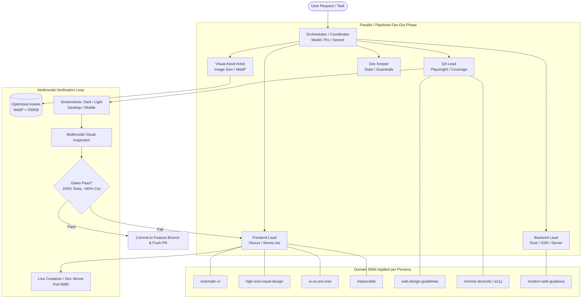

# Multimodal Fan-Out Architecture & Skill Orchestration System

**Version**: 2.0.0  
**Status**: Authoritative Architectural Standard  
**Applies to**: Vaelvet UI/UX, Rust Services, CI/CD, and Autonomous Agent Teams

---

## 1. System Overview

The Vaelvet project employs an **Autonomous Multimodal Fan-Out Architecture**. Complex engineering, design, and QA tasks are never executed as a monolithic, single-agent stream. Instead, tasks are coordinated by a primary **Orchestrator Agent** that decomposes work into bounded scopes, delegating execution across specialized **Subagents**, **Multimodal Engines**, and **Domain-Specific Skills**.



---

## 2. Multi-Model Tiering & Routing

Agents and tasks are routed to the optimal model based on reasoning intensity, token economy, and multimodal requirements:

| Model Tier | AGY / Antigravity Model | Claude Equivalent | Task Scope & Responsibilities |
|---|---|---|---|
| **Tier 1: Deep Reasoning & Coordination** | `pro` / `inherit` | `claude-sonnet-4-6` | Architectural decisions, complex Rust refactors, TDD red-green cycle, WebKit scroll-snap debugging, gate evaluation. |
| **Tier 2: Fast & Focused Tasks** | `flash` | `claude-haiku-4-5` | Targeted unit test additions, regex tuning, file searches, lint fixes, single-function modifications. |
| **Tier 3: Routine Docs & Housekeeping** | `flash_lite` | `claude-haiku-4-5` | Documentation sync (`STATE.md`, `TASKS.md`, `PROGRESS.md`), changelog updating, formatting checks. |
| **Multimodal: Visual Generation** | `image-generator` | Midjourney / DALL-E / Imagen API | Authentic cultural production photography generation, cinematic staging briefs, camera angle composition. |
| **Multimodal: Visual QA & Audit** | Multimodal Vision (Pro/Sonnet) | Vision-enabled Sonnet | Inspecting desktop/mobile and dark/light screenshots for contrast, transparency, framing, and visual balance. |

---

## 3. Persona → Task → Skill Topology

Each persona possesses a clear scope boundary and loads only the skills necessary for its phase:

### 3.1 `frontend-lead`
* **Scope**: `velvet-ui/src/components/*`, `velvet-ui/assets/theme.css`, `velvet-ui/public/assets/theme.css`.
* **Permanent Constraints**:
  * Dual CSS synchronization (assets and public must remain 100% byte-for-byte identical).
  * Card transparency (`alpha <= 0.2`) via `var(--glass-card-fill)`.
  * Clean 4-column glass stat grid (`.v-stat-grid--four`); zero heatmap letterform grid clutter.
  * Bounded full-tile panoramic framing (`.v-tile--full` height < 500px, photo height `clamp(170px, 18vw, 235px)`, `object-position: center 36%`, image positioned above copy).
* **Skills Loaded**:
  * `cinematic-ui`: Glassmorphism rules, sparkle running borders, unique peek-in scroll animations per card type.
  * `high-end-visual-design`: High-contrast typography (`Outfit`, `IBM Plex Sans`), crimson/off-white palette, generous negative space.
  * `ui-ux-pro-max`: Layout metrics, responsive clamping, micro-interactions.
  * `impeccable`: Visual hierarchy, cognitive load minimization, component distillation.

### 3.2 `visual-asset-artist`
* **Scope**: Media briefs, asset generation, WebP compression, responsive asset placement.
* **Permanent Constraints**:
  * Authentic Indian and Odia cultural photography:
    * `workflow-03-production.webp`: Konark open-stage Odissi classical dance filming set with professional cinema camera behind the stage.
    * `studio-07-creators.webp`: Authentic Indian model filming high-quality social media video via smartphone in natural outdoor lighting.
  * Production-grade WebP format (< 250 KB per asset).
  * Reusable, config-driven asset pointers in `content/site.md`.
* **Skills Loaded**:
  * `image-generator` subagent invocation.
  * Image compression utilities (`sips`, `cwebp`, `ffmpeg`).

### 3.3 `qa-lead`
* **Scope**: `test-suite/playwright/*`, `tests/*`, unit tests in `velvet-ui` and `server`.
* **Permanent Constraints**:
  * 100% passing Playwright tests across 3 projects: `chromium`, `webkit`, and `reduced-motion` (327+ tests).
  * WebKit scroll-snap reveal compatibility via coordinate window scrolling (`window.scrollTo(0, window.scrollY + el.getBoundingClientRect().top - window.innerHeight / 3)`).
  * Strict **> 90% Rust logic coverage** enforced via `cargo llvm-cov`.
* **Skills Loaded**:
  * `web-design-guidelines`: Accessibility standards, luminance checks, tap target validation.
  * `chrome-devtools` & `a11y-debugging`: Deep DOM inspection and layout measurement.

### 3.4 `backend-lead`
* **Scope**: `server/src/*`, `velvet-ui/src/config.rs`, SSR rendering tests.
* **Permanent Constraints**:
  * Zero `unwrap()`, `expect()`, `panic!()` in library/production code.
  * Axum security headers, path traversal defense, static asset caching with `dxh` hashing.
  * Config loading with strict CLI > ENV > File > Defaults precedence.
* **Skills Loaded**:
  * `modern-web-guidance`: HTTP caching standards, security headers, WASM loading semantics.

### 3.5 `doc-keeper`
* **Scope**: `STATE.md`, `CLAUDE.md`, `AGENT_DIRECTIVE.md`, `.agents/AGENTS.md`, `test-suite/coverage-goals.md`.
* **Permanent Constraints**:
  * Always update progress and state before ending sprints.
  * Keep all documentation in lockstep with code implementations.

---

## 4. Fan-Out Execution Workflow

When executing complex tasks, the Orchestrator follows a 5-phase loop:

```
Phase 0: State Discovery & Requirement Parsing
  └─ Read STATE.md, TASKS.md, git status
  └─ Parse user visual, functional, and test requirements

Phase 1: Task Decomposition & Scope Whitelisting
  └─ Split into isolated workstreams (e.g. Asset Gen, UI Code, QA Specs)
  └─ Assign explicit file paths to prevent subagent merge conflicts

Phase 2: Parallel / Subagent Fan-Out Execution
  └─ Dispatch visual asset creation to `image-generator`
  └─ Dispatch backend/UI implementation to `code-writer` / `frontend-lead`
  └─ Subagents execute with phase-specific skills

Phase 3: Integration & Dual CSS Synchronization
  └─ Integrate new assets into `content/site.md` and `assets/images/`
  └─ Replicate any CSS change byte-for-byte in both theme.css locations
  └─ Rebuild WASM via `dx build --release`

Phase 4: Multi-Tier Verification Gates
  └─ Gate 1: Code hygiene (`cargo fmt --check`, `clippy -D warnings`)
  └─ Gate 2: Full Rust test suite (all unit, SSR, and integration tests pass)
  └─ Gate 3: Coverage floor (`cargo llvm-cov` >= 90% lines)
  └─ Gate 4: Multi-project Playwright suite (Chromium, WebKit, Reduced Motion)
  └─ Gate 5: Security audit (`cargo audit --deny warnings`, `cargo deny`)
  └─ Gate 6: Multimodal visual inspection (mobile/desktop, dark/light screenshots)

Phase 5: Commit, Guardrail Recording & Reporting
  └─ Update .agents/AGENTS.md, CLAUDE.md, STATE.md
  └─ Commit to isolated feature branch with Conventional Commit format
  └─ Push branch and provide structured summary
```

---

## 5. Token Economy & Context Preservation

To prevent context window bloat and degradation during multi-agent workflows:

1. **Structured Subagent Outputs**: Subagents return condensed diff summaries, file paths, and test metrics—never dumping full file contents into the parent context.
2. **Phase-Gated Skill Loading**: Heavy design skills (`ui-ux-pro-max`, `impeccable`) load only during the UI design/polish phase and are kept unloaded during the initial red/green TDD phase.
3. **Targeted Reading**: Use symbol lookups, grep, or section reads rather than reading entire monolithic files.
4. **Durable Memory Protocol**: `STATE.md` and `TASKS.md` act as the persistent source of truth so context can be compacted (`/compact`) at any time without losing sprint memory.
